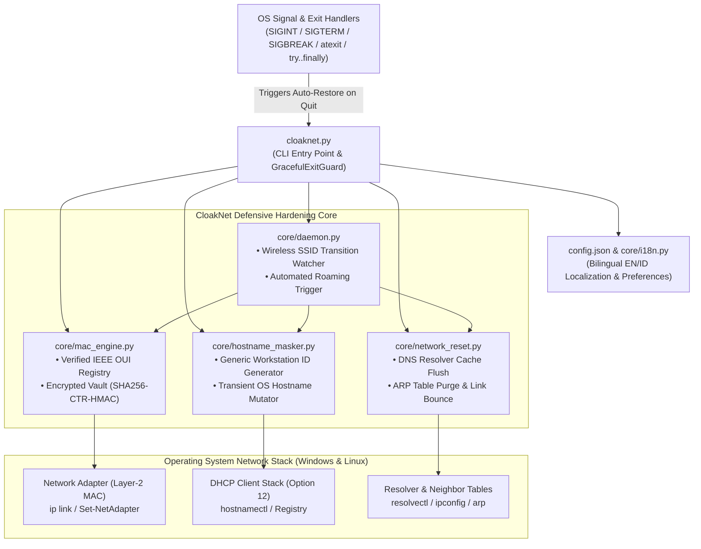

# CloakNet: Automated Layer-2 Identity Obfuscation & Local Traffic Randomizer

<p align="center">
  <a href="https://github.com/x90d/CloakNet"></a>
  <a href="https://github.com/x90d/CloakNet"></a>
  <a href="https://github.com/x90d/CloakNet"></a>
  <a href="https://github.com/x90d/CloakNet/blob/main/LICENSE"></a>
  <a href="https://github.com/x90d/CloakNet/releases"></a>
</p>

> **Defensive endpoint privacy utility that automates IEEE OUI-compliant MAC address rotation, transient DHCP hostname masking, local resolver/ARP cache hygiene, and deterministic auto-restoration across untrusted wireless and LAN environments.**

<p align="center"><video src="assets/video.gif" width="100%" autoplay loop muted playsinline controls></video></p>

---

## Table of Contents

1. [Problem Statement: Layer-2 Tracking & Profiling Risks on Public Wi-Fi](#1-problem-statement-layer-2-tracking--profiling-risks-on-public-wi-fi)
2. [Core Features](#2-core-features)
3. [System Architecture & Graceful Exit Lifecycle](#3-system-architecture--graceful-exit-lifecycle)
4. [Quickstart Guide](#4-quickstart-guide)
5. [CLI Usage Reference](#5-cli-usage-reference)
6. [Security & Ethical Disclaimer](#6-security--ethical-disclaimer)
7. [License](#7-license)

---

## 1. Problem Statement: Layer-2 Tracking & Profiling Risks on Public Wi-Fi

When an endpoint connects to a public or semi-trusted local network—such as airport lounges, hotel networks, co-working spaces, or conference Wi-Fi—it broadcasts persistent hardware and operating system identifiers at **OSI Layer-2 (Data Link)** and **Layer-7 (DHCP/DNS)** before any VPN or TLS tunnel is established:

- **Hardware MAC Address Persistence**: Factory-assigned Media Access Control (MAC) addresses uniquely identify both the Network Interface Card (NIC) manufacturer and the individual physical device, allowing captive portals, retail analytics sensors, and passive wireless monitors to correlate movement and session history across physical locations.
- **Naive Randomization Rejections**: Basic scripts that generate purely random 48-bit hex strings frequently set the multicast bit or use unallocated Organizationally Unique Identifier (OUI) prefixes, triggering 802.1X port security blocks or captive portal DHCP drops.
- **DHCP Hostname Leakage**: Operating systems routinely transmit the machine's configured hostname (often containing an employee's name, corporate asset tag, or device model) inside **DHCP Option 12 (Host Name)** and **Option 81 (Client FQDN)** packets in cleartext.
- **Residual ARP & DNS Cache Correlation**: Stale Address Resolution Protocol (ARP) neighbor tables and local DNS resolver caches retain artifacts from prior network segments, increasing exposure to local cache poisoning and cross-network fingerprinting.

**CloakNet** addresses these risks defensively by rotating the adapter's Layer-2 address using verified IEEE vendor OUIs, masking the system's transient DHCP hostname, flushing local DNS and ARP state cleanly upon network transitions, and automatically restoring original hardware parameters upon termination.

---

## 2. Core Features

- **IEEE OUI-Verified MAC Randomization (`core/mac_engine.py`)**: Generates unicast hardware MAC addresses using official vendor prefixes from **Intel, Realtek, Apple, Dell, Lenovo, Supermicro, Cisco, and Qualcomm** so routers and captive portals treat the interface as standard enterprise hardware.
- **Authenticated Encrypted Identity Vault (`.cloaknet_vault/`)**: Automatically backs up the original factory MAC address and system hostname in an HMAC-SHA256 authenticated encrypted local vault (`identity_backup.enc`) prior to rotation.
- **Graceful Exit & Automatic Identity Restoration (`GracefulExitGuard`)**: Intercepts OS termination signals (`SIGINT` / `Ctrl+C`, `SIGTERM`, and Windows `SIGBREAK`) alongside `atexit` hooks and `try...finally` blocks. When `--daemon`, `--randomize --hold`, or the interactive console is quit, CloakNet automatically invokes the `--restore` routine to revert the adapter's original MAC address and system hostname before exiting. Manual recovery is also available at any time via `python cloaknet.py --restore`.
- **Transient DHCP Hostname Masking (`core/hostname_masker.py`)**: Replaces revealing device names with standard workstation identifiers (such as `DESKTOP-9X2A1F` or `WORKSTATION-42B`) before DHCP lease negotiation.
- **Graceful Network Cache Hygiene (`core/network_reset.py`)**: Flushes the operating system DNS resolver cache (`ipconfig /flushdns` / `resolvectl`), purges local ARP neighbor tables (`arp -d` / `ip neigh flush`), and cycles the network interface gracefully without freezing active user sessions.
- **Autonomous Wireless SSID Transition Daemon (`core/daemon.py`)**: Continuously monitors wireless interface associations (`netsh wlan` / `iwgetid` / `nmcli`) and triggers automatic Layer-2 identity rotation whenever the endpoint roams onto a new SSID.
- **Bilingual CLI Interface (`core/i18n.py`)**: Supports real-time output localization in **English (`en`, Default)** and **Bahasa Indonesia (`id`)** via `--lang`, `--set-lang`, or `config.json`.

---

## 3. System Architecture & Graceful Exit Lifecycle

### Mermaid Component Diagram



### ASCII Execution & Auto-Restore Flow

```text
+-----------------------------------------------------------------------------+
|                   USER INVOCATION (cloaknet.py / run.bat)                   |
|   Flags: --randomize | --hold | --restore | --daemon | --status | --lang    |
+--------------------------------------+--------------------------------------+
                                       |
                                       v
+--------------------------------------+--------------------------------------+
|                1. ENCRYPTED VAULT CHECK (.cloaknet_vault/)                  |
|  • Verifies HMAC-SHA256 integrity of existing backup envelope               |
|  • Persists original factory MAC & hostname before first modification       |
+--------------------------------------+--------------------------------------+
                                       |
            +--------------------------+--------------------------+
            |                                                     |
            v (--randomize / --daemon)                            v (--restore / SIGINT / Quit)
+-----------+-------------------------------+   +-----------------+-----------+
| 2A. OUI MAC & HOSTNAME OBFUSCATION        |   | 2B. AUTO OR MANUAL RESTORE  |
| • Selects verified IEEE OUI (Intel/Apple) |   | • Triggered by CTRL+C,      |
| • Generates 24-bit cryptographic NIC tail |   |   SIGTERM, atexit, or       |
| • Assigns generic DESKTOP-XXXXXX hostname |   |   manual `--restore` flag   |
| • Flushes DNS resolver & ARP neighbor tbl |   | • Reverts original MAC/Host |
+-------------------------------------------+   +-----------------------------+
```

---

## 4. Quickstart Guide

### Clone the Repository

```bash
git clone https://github.com/x90d/CloakNet.git
cd CloakNet
```

### Option A: One-Click Execution on Windows (`run.bat`)

Run `run.bat` from an elevated Command Prompt, PowerShell, or Windows Explorer:

```bat
.\run.bat
```

`run.bat` automatically checks for Python 3.9+, provisions an isolated `.venv` virtual environment if absent, installs required packages from `requirements.txt` if not yet installed, and launches the interactive CloakNet console (or forwards any CLI flags you supply, e.g., `.\run.bat --randomize`). When you exit the console or press `CTRL+C`, CloakNet automatically restores your original hardware MAC address and hostname.

### Option B: One-Click Execution on Linux / macOS (`run.sh`)

```bash
chmod +x run.sh
sudo ./run.sh --status
```

### Option C: Manual Virtual Environment Setup

```bash
python3 -m venv .venv
source .venv/bin/activate        # On Windows: .\.venv\Scripts\activate
pip install -r requirements.txt
python cloaknet.py --status
```

---

## 5. CLI Usage Reference

```text
usage: cloaknet [-h] [-i INTERFACE] [-r] [--hold] [--restore] [-d]
                [--daemon-cycles DAEMON_CYCLES] [--no-auto-restore] [-s]
                [--vendor VENDOR] [--lang {en,id}] [--set-lang {en,id}]
                [--dry-run]
```

### Common Operational Examples

| Operation | Command | Description |
| :--- | :--- | :--- |
| **Inspect Current Posture** | `python cloaknet.py --status` | Displays current hostname, active SSID, vault backup status, and all network interfaces. |
| **Randomize Identity (One-Shot)** | `sudo python cloaknet.py --randomize` | Backs up original identity in `.cloaknet_vault/`, applies a verified IEEE OUI MAC, masks hostname, and flushes DNS/ARP caches. |
| **Randomize & Hold (Auto-Restore on Ctrl+C)** | `sudo python cloaknet.py --randomize --hold` | Keeps the obfuscated identity active in the foreground and automatically restores the original MAC & hostname when `CTRL+C` (`SIGINT`/`SIGTERM`) is pressed. |
| **Manual Restore Identity** | `sudo python cloaknet.py --restore` | Manually restores factory MAC address and original hostname from `.cloaknet_vault/identity_backup.enc`. |
| **Start SSID Watch Daemon** | `sudo python cloaknet.py --daemon` | Monitors Wi-Fi transitions in the background, rotates identity on new SSIDs, and automatically restores original identity on exit (`CTRL+C`). |
| **Keep Spoofed State After Daemon Exit** | `sudo python cloaknet.py --daemon --no-auto-restore` | Disables automatic exit restoration so the randomized MAC remains active until manual `--restore`. |
| **Specify Interface & Vendor** | `sudo python cloaknet.py -i wlan0 -r --vendor Intel` | Rotates MAC on `wlan0` specifically using an Intel Corporate OUI prefix. |
| **Use Bahasa Indonesia** | `python cloaknet.py --randomize --lang id` | Executes the hardening workflow with full Bahasa Indonesia console output. |
| **Persist Default Language** | `python cloaknet.py --set-lang id` | Saves Bahasa Indonesia (`id`) or English (`en`) as the permanent default in `config.json`. |

---

## 6. Security & Ethical Disclaimer

**CloakNet** is developed strictly as a **defensive endpoint privacy and local network hardening utility** to protect mobile workstations against unauthorized Layer-2 tracking, passive wireless profiling, and DHCP metadata leakage on public or untrusted networks.

- CloakNet does **not** perform ARP spoofing, MITM interception, packet injection, deauthentication attacks, or unauthorized access against third-party systems.
- Users are solely responsible for complying with their organization's network access control (NAC / 802.1X) policies and applicable local regulations before modifying network adapter parameters.

---

## 7. License

Distributed under the **MIT License**